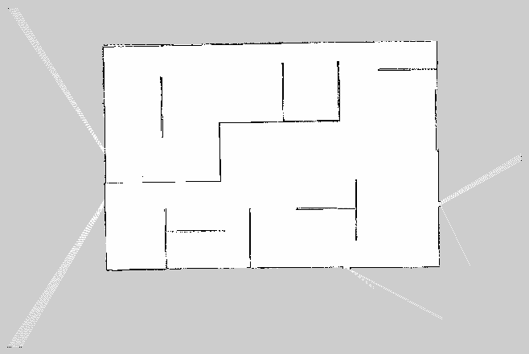
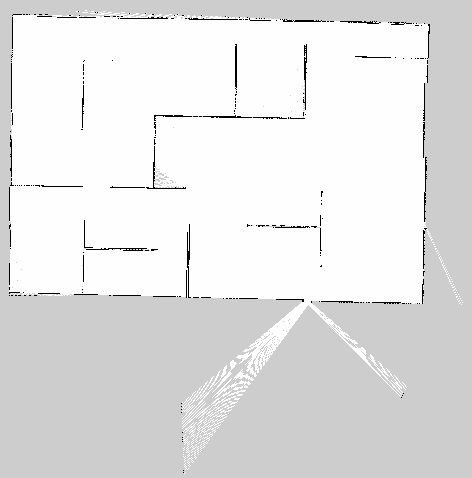
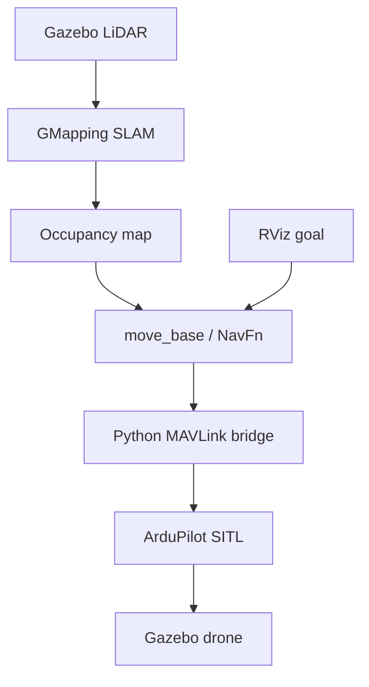

# ros1-drone-slam-navigation

**Simulated ROS 1 quadrotor with 2D LiDAR SLAM and RViz goal-directed autonomous flight** — ROS Noetic · Gazebo · ArduPilot SITL · gmapping · move_base · MAVROS · pymavlink.

A quadrotor simulated in Gazebo and flown by ArduPilot SITL builds a 2D occupancy map of a walled world with `gmapping`. A goal clicked in RViz is planned by `move_base` (NavFn), and a custom Python node converts the planned path into a MAVLink mission for the drone.

> **Archival project (2024).** This is a cleaned, source-only release of a personal project built on Ubuntu 20.04 / ROS Noetic. It has **not** been re-run since archiving, and the archived ROS-to-MAVLink bridge contains an unresolved coordinate-conversion discrepancy. Read [Status and limitations](#status-and-limitations) before relying on it.

## Demo

[](https://youtu.be/c8f3adqbQ-4)

*Click to watch the original 2024 demonstration on YouTube: the simulated drone flying to goals selected in RViz. The video is the author's recording of the historical system, not output of the code in this repository.*

**Write-ups:** [LinkedIn: Utilizing LiDAR in Drone Simulation](https://lnkd.in/p/dekMzetw) · [LinkedIn: Finally, Autonomous Drone Navigation!](https://lnkd.in/p/d3wsPAYf) · Medium ([profile](https://medium.com/@alaaRadhwan)): [Let's get this drone flying](https://medium.com/@alaaRadhwan/lets-get-this-drone-flying-6233f28b90de) · [Utilizing LiDAR in Drone Simulation](https://medium.com/@alaaRadhwan/utilizing-lidar-in-drone-simulation-5f1f645e1b64) · [Milestone Reached](https://medium.com/@alaaRadhwan/milestone-reached-5a172615f679)

## SLAM maps

| `my_map` (29 Jul 2024) | `map2` (3 Aug 2024) |
|:---:|:---:|
|  |  |

*Portfolio visualizations of two saved gmapping occupancy grids (cropped from 4000×4000 maps at 0.05 m/pixel; free = white, occupied = black, unknown = grey). They are images for viewing only, not loadable maps. See [docs/evidence/README.md](docs/evidence/README.md).*

## Architecture at a glance



*MAVROS odometry is the author's recollection of the final demonstration; see [Odometry sources](#odometry-sources-as-evidenced).* The custom integration work is the RViz goal → planner → **Python MAVLink bridge** → ArduPilot SITL chain, the TF and SLAM configuration, the LiDAR drone model and walled world, and a Flask/Leaflet ground station. Detailed navigation, SLAM and odometry/TF diagrams: [docs/ARCHITECTURE.md](docs/ARCHITECTURE.md).

## Status and limitations

| Claim | Status |
|---|---|
| gmapping and move_base configuration, TF broadcaster, RViz → plan → MAVLink bridge, Flask ground station | **Implemented and preserved in source** |
| Saved occupancy-grid maps and two recorded TF-tree snapshots | **Preserved artifacts** (`docs/evidence/`) |
| Drone flew autonomously to RViz-selected goals in Gazebo | **Demonstrated historically; confirmed by the author** |
| Final demo used MAVROS/ArduPilot odometry (not Gazebo ground truth) | **Author's recollection.** One archived TF snapshot (`frames.gv`) is consistent with it; the MAVROS TF configuration itself was not preserved |
| This repository's code reproduces that behaviour | **Not independently verified** |
| Mapping accuracy, localization error, goal-reach rate | **No measurements exist; none are claimed** |
| Real hardware | **None — simulation only** |

Main caveats (details in [docs/KNOWN_LIMITATIONS.md](docs/KNOWN_LIMITATIONS.md)):
- **Coordinate conversion:** the archived bridge writes map-frame metres into MAVLink latitude/longitude fields (`x * 1e7`). Despite the author-observed successful flights, the archive does not explain this. The historical code is preserved unmodified.
- **Odometry:** two archived TF snapshots show two different odometry sources (see below); the exact configuration of the final video is not recoverable from files.
- **Reproducibility:** untested since archiving; no rosbags, logs or quantitative evaluation survive; the original PGM maps are not included. See [docs/REPRODUCIBILITY.md](docs/REPRODUCIBILITY.md).

### Odometry sources, as evidenced

1. **Final demonstration (author recollection):** MAVROS/ArduPilot odometry.
2. **`docs/evidence/frames.gv`** (saved 29 Jul 2024, later snapshot): `/mavros` publishes `odom → base_link`; static `base_to_hokuyo` / `hokuyo_to_sensor` publishers (the names used in `gmapping.launch`) provide the Hokuyo frames; `/slam_gmapping` publishes `map → odom`.
3. **`docs/evidence/frames.png`** (saved 26 Jul 2024, earlier snapshot): `/tf_broadcaster` publishes `odom → base_link` and the Hokuyo frames — the Gazebo ground-truth broadcaster (`overlay/iq_sim/scripts/tf_broadcaster.py`), apparently an earlier or alternative test configuration.

## Repository layout

```
overlay/iq_sim/      Files to overlay onto upstream Intelligent-Quads iq_sim (launch, config, scripts, world, drone model)
ground_station/      Flask + Socket.IO + Leaflet web ground station (Server3.0 snapshot)
rviz/                RViz configurations
scripts/             Original multi-terminal launcher (start_gmapping_project.sh)
prototypes/          Earlier path-to-MAVLink experiment kept for history
tools/               Non-historical reference utility for the coordinate question
docs/                Architecture, limitations, reproducibility, release audit
docs/evidence/       Map visualizations + map metadata (yaml), TF snapshots
```

## Quick start (untested; see [docs/REPRODUCIBILITY.md](docs/REPRODUCIBILITY.md))

```bash
git clone https://github.com/Intelligent-Quads/iq_sim.git ~/catkin_ws/src/iq_sim
git -C ~/catkin_ws/src/iq_sim checkout 13e72512cd9748b12a4aa1cac15a2e34b1cdcfd6
cp -r overlay/iq_sim/* ~/catkin_ws/src/iq_sim/ && chmod +x ~/catkin_ws/src/iq_sim/scripts/*.py
cd ~/catkin_ws && catkin build && source devel/setup.bash
roslaunch iq_sim walls.launch                    # Gazebo world
~/catkin_ws/src/iq_sim/scripts/startsitl.sh      # ArduPilot SITL
roslaunch iq_sim apm.launch                      # MAVROS (odometry/TF configuration was not preserved)
roslaunch iq_sim gmapping.launch                 # SLAM
roslaunch iq_sim navigation.launch               # move_base
rosrun iq_sim navigation_test.py                 # plan -> MAVLink bridge (archived, see limitations)
rviz -d rviz/navigation.rviz
```

## Authorship and credits

Developed independently by Alaa Radhwan in 2024, with ChatGPT assistance at the time, using established open-source robotics frameworks. The custom code and configuration were written and integrated by the author.

This project **uses, and does not claim to have created**, ROS, Gazebo, `gmapping`, `move_base`/NavFn, ArduPilot, MAVLink/pymavlink, MAVROS, the ArduPilot Gazebo plugin, or the Intelligent-Quads `iq_sim` base. See [THIRD_PARTY_NOTICES.md](THIRD_PARTY_NOTICES.md).

## License

MIT for the author's original contributions ([LICENSE](LICENSE)). Third-party components keep their own licenses.
