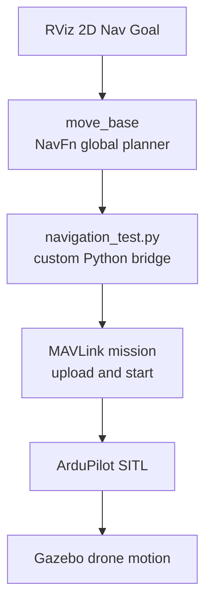
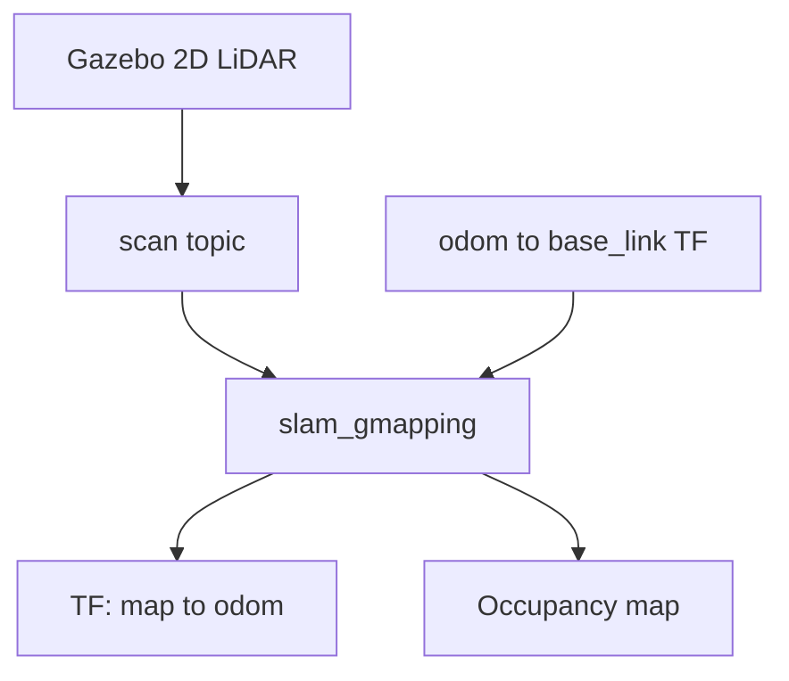
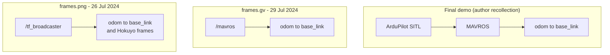

# Architecture

Everything below comes from the preserved source (`overlay/iq_sim`, `ground_station`) and the two recorded TF snapshots in `docs/evidence/`. Items that rest on the author's recollection are marked. Details are kept in tables and text below each diagram rather than inside the diagrams.

## 1. Navigation pipeline

| Step | Detail | Source |
|---|---|---|
| RViz goal | Published on `/move_base_simple/goal` | `rviz/navigation.rviz` |
| `move_base` | NavFn global planner, TrajectoryPlannerROS local planner; plan on `/move_base/NavfnROS/plan` | `launch/navigation.launch`, `config/*.yaml` |
| Python bridge | `GoalToMAVLink` subscribes to the plan, clears the mission, converts every pose to `MISSION_ITEM_INT`, then sets GUIDED, arms, sets AUTO and sends `MISSION_START` | `scripts/navigation_test.py` |
| Link to the vehicle | pymavlink over UDP 14550 | `scripts/navigation_test.py` |
| ArduPilot SITL | ArduCopter SITL started with `sim_vehicle.py -f gazebo-iris` | `scripts/startsitl.sh` |
| Gazebo drone | ArduPilot plugin exchanges motor and sensor data with Gazebo over UDP 9002/9003 | `models/drone_with_lidar_camera/model.sdf` |

The map-to-latitude/longitude conversion inside the bridge is an unresolved archival discrepancy; see [KNOWN_LIMITATIONS.md](KNOWN_LIMITATIONS.md#1-coordinate-conversion-in-the-path-to-mavlink-bridge-unresolved).

## 2. SLAM and sensing pipeline

| Item | Detail |
|---|---|
| LiDAR | Hokuyo-style 2D scan, 1024 beams over ±π, 10 Hz, 30 m range; frame `hokuyo_sensor_link` |
| Scan topic | `/spur/laser/scan`, remapped into gmapping |
| `slam_gmapping` | `gmapping.launch`: 80 particles, linear/angular update 0.2/0.2. `start_gmapping.launch`: 30 particles, `delta` 0.025 |
| Outputs | `/map` occupancy grid and the `map → odom` transform; the map feeds the `move_base` global costmap |
| Odometry input | The `odom → base_link` transform. Its source is discussed in section 3 |
| Saved maps | 0.05 m/pixel, origin (−100, −100); see [evidence](evidence/README.md) |

## 3. Odometry / TF evidence (comparison, not the system pipeline)

This diagram compares three pieces of evidence about where `odom → base_link` came from. It is not a runtime architecture.

## TF and odometry: what the evidence shows

gmapping needs a `odom → base_link` transform and a transform to the LiDAR frame. Three separate pieces of information exist, and they are not identical:

| Source | What it says |
|---|---|
| **Author recollection** | In the final working navigation demonstration, odometry came from MAVROS/ArduPilot, not directly from Gazebo. |
| **`docs/evidence/frames.gv`** (saved 29 Jul 2024 21:48, the later snapshot) | `/mavros` broadcasts `odom → base_link` (≈4.2 Hz) plus its NED helper frames (`map_ned`, `odom_ned`, `base_link_frd`). `/base_to_hokuyo` and `/hokuyo_to_sensor` (same node names as the static publishers in the current `gmapping.launch`, which was last modified a day later) broadcast the Hokuyo frames. `/slam_gmapping` broadcasts `map → odom` (≈20 Hz). |
| **`docs/evidence/frames.png`** (saved 26 Jul 2024 11:20, the earlier snapshot) | `/tf_broadcaster` broadcasts `odom → base_link`, `base_link → hokuyo_link` and `hokuyo_link → hokuyo_sensor_link` (≈360–376 Hz); `/slam_gmapping` broadcasts `map → odom` (≈21 Hz). No MAVROS TF. |
| **Source** | `overlay/iq_sim/scripts/tf_broadcaster.py` derives `odom → base_link` from the Gazebo ground-truth pose (`/gazebo/model_states`, model `drone_with_lidar_camera`) and adds the Hokuyo offsets. It was last modified 27 Jul 2024, after the `frames.png` snapshot, so the snapshot used an earlier revision. |

The two snapshots are consistent with a ground-truth-TF configuration (26 Jul) that was later replaced by a MAVROS-odometry configuration (29 Jul), which matches the author's recollection of the final demo. The files do not prove that the 29 Jul configuration is the one in the final video.

### How MAVROS odometry reached gmapping — not fully recoverable

- `gmapping.launch` (30 Jul 2024) comments out `odom_frame`, so gmapping uses its default `odom`, and it defines the two static Hokuyo transforms itself. This is consistent with an external source publishing `odom → base_link` (MAVROS) and with the `frames.gv` snapshot. It does not run `tf_broadcaster.py`.
- The MAVROS launch files in the repository (`apm.launch`, `mavros_node.launch`) load the **system-installed** `mavros/launch/apm_config.yaml` and `apm_pluginlists.yaml`. No custom MAVROS parameter file exists in the backup.
- In upstream MAVROS, the `local_position` plugin does **not** broadcast TF unless `tf/send` is true, and its default TF is `map → base_link`. So `odom → base_link` coming from `/mavros` (as in `frames.gv`) implies that MAVROS frame/TF parameters were set differently from the stock defaults, through a modified config or parameter overrides that the backup did not preserve. The exact mechanism (which plugin and which parameters) is **unknown**; this repository does not assume one.
- `start_gmapping_project.sh` does not start MAVROS. An older archived launcher (`start_droneweb.sh`, not included in this repository) contains the comment: `roslaunch mavros apm.launch fcu_url:="udp://:14551@localhost:14551"  # To launch mavros and get the odom data`, which indicates MAVROS was started manually for odometry.
- `start_gmapping_project.sh` also starts `tf_broadcaster.py` alongside `gmapping.launch`. Together these would publish the Hokuyo transforms twice and would conflict with MAVROS publishing `odom → base_link`. Which components were actually running in the final demo is therefore unconfirmed.

## Components

| Component | File | Role |
|---|---|---|
| World | `overlay/iq_sim/worlds/walls.world` | Walled indoor environment (`grey_wall` models, AWS GroundB floor) |
| Drone | `overlay/iq_sim/models/drone_with_lidar_camera/` | Iris + 2D Hokuyo-style LiDAR (`/spur/laser/scan`) + camera; meshes come from upstream `iris_base` |
| SLAM | `launch/gmapping.launch`, `launch/start_gmapping.launch` | `slam_gmapping`, scan remapped to `/spur/laser/scan` |
| Navigation | `launch/navigation.launch`, `config/*.yaml` | `move_base`: NavFn global planner, TrajectoryPlannerROS local planner, costmaps |
| TF (alternative) | `scripts/tf_broadcaster.py`, `launch/tf_publisher.launch` | Ground-truth `odom → base_link` plus Hokuyo frames |
| Bridge | `scripts/navigation_test.py` | `/move_base/NavfnROS/plan` → MAVLink mission → GUIDED / ARM / AUTO / MISSION_START |
| Goal relay | `scripts/rviz_nav_goal_publisher.py` | `/move_base_simple/goal` → `/mavros/setpoint_position/global` (see limitations) |
| Ground station | `ground_station/server_apps/` | Flask + Socket.IO + Leaflet UI, pymavlink control, camera feed |

## Key parameters (as archived)

- `gmapping.launch`: 80 particles, linear/angular update 0.2/0.2, temporal update 1.0, resample threshold 0.5. `start_gmapping.launch`: 30 particles, `delta` 0.025, ±100 m map.
- `move_base`: `navfn/NavfnROS` + `base_local_planner/TrajectoryPlannerROS`; robot radius 0.35 m; obstacle range 2.5 m, raytrace range 3.0 m; local costmap 6×6 m rolling window at 0.05 m.
- Saved maps: 0.05 m/pixel, origin (−100, −100).
